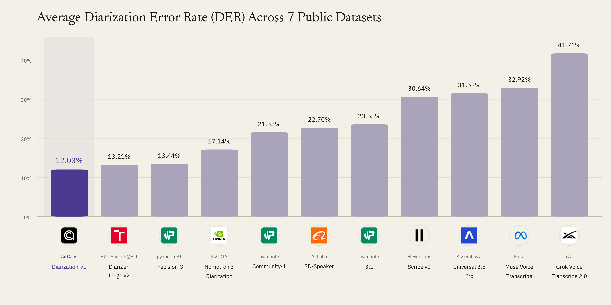
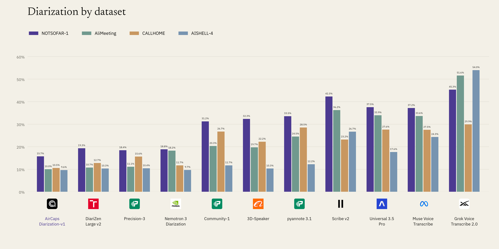
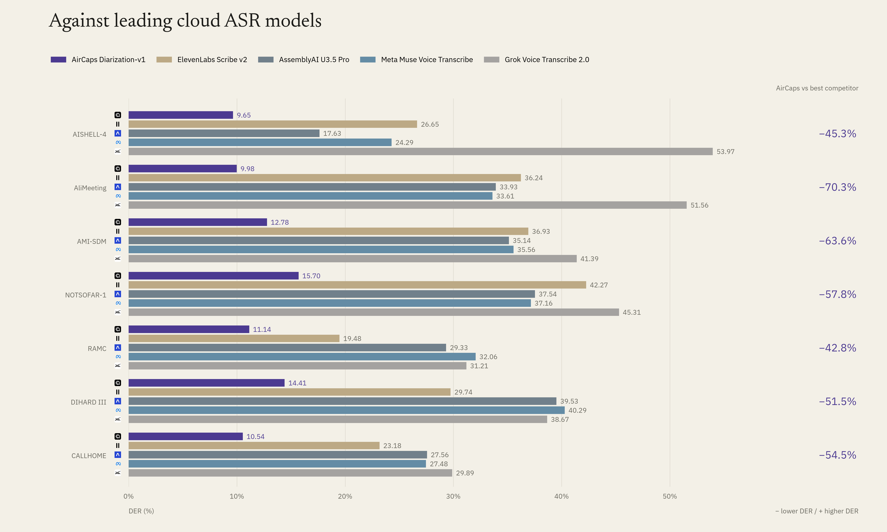

# AirCaps Diarization Benchmark

Evaluation code, frozen recording manifests, original model predictions, provider responses and per-recording scores behind the AirCaps Diarization-v1 research page. **AirCaps scores 12.03% average DER across seven datasets.**

**Model:** [AirCaps Diarization-v1](https://aircaps.ai/models/diarization) · **Report:** [Diarization-v1 research note](https://aircaps.ai/research/aircaps-diarization-v1-who-spoke-when-in-real-world-audio) · **API:** [AirCaps AI docs](https://aircaps.ai/docs)

This release lets you **reproduce the scores from saved predictions** without a GPU or API calls. It also includes the third-party inference adapters and exact recorded request settings for new runs. AirCaps implementation and weights are not part of this release; its final RTTM predictions are included. Original audio and reference annotations must be obtained from their owners.

## Reproduce the results

```bash
git clone https://github.com/aircaps/AirCaps-Diarization-Benchmark.git
cd AirCaps-Diarization-Benchmark
python3 -m venv .venv
source .venv/bin/activate
pip install -r requirements.txt
# Acquire source datasets, then edit this map to their extracted locations:
cp datasets/sources.example.json datasets/sources.local.json
python -m benchmark.prepare --sources datasets/sources.local.json --output data
python -m benchmark.reproduce --references data
python -m benchmark.verify_results --scores recomputed
python -m unittest discover -s tests
```

Start with [dataset preparation](docs/DATASETS.md), then [scoring and exclusions](docs/SCORING.md). The preparation and scorer check reference hashes against the 1,260-recording manifest and stop on mismatches. For a quick single-system run:

```bash
python -m benchmark.score --references data   --hypotheses outputs/rttm/aircaps-v1 --workers 4   --output recomputed/aircaps-v1.json
```

`results/recomputed/` contains the release audit, including every scored recording. `results/verification.json` checks **66 measured values in the website data** against the website at its displayed two-decimal precision. Another **29 cells are published-only baselines**; no original predictions were available for them. They are identified separately rather than presented as locally reproduced results.

For fresh inference, see [model and API runners](docs/INFERENCE.md). Fresh GPU results can vary with hardware and dependencies; hosted providers can change behind a model identifier. Saved-output rescoring is the verified reproduction path.

## Results

DER (%) — lower is better. The primary average gives seven datasets equal weight. Our measured results use the frozen original annotations, zero collar and overlap included. The four ASR providers use the same 1.0-second gap-bridging rule. Some published baseline cells use different splits or scoring details; this is not a reference-independent ranking.

### Seven primary datasets

| System | AISHELL-4 | AliMeeting | AMI-SDM | NOTSOFAR-1 | RAMC | DIHARD III | CALLHOME | Average DER |
| --- | ---: | ---: | ---: | ---: | ---: | ---: | ---: | ---: |
| AirCaps Diarization-v1 | 9.65 | 9.98 | 12.78 | 15.70 | 11.14 | 14.41 | 10.54 | 12.03 |
| DiariZen Large v2 | 10.30 | 10.74 | 13.92 | 19.31 | 10.99 | 14.46 | 12.74 | 13.21 |
| pyannoteAI Precision-3 | 10.40 | 11.10 | 13.50 | 18.40 | 10.50 | 14.60 | 15.60 | 13.44 |
| Nemotron 3 Diarization | 9.69 | 18.25 | 27.66 | 18.81 | 21.13 | 12.72 | 11.70 | 17.14 |
| pyannote Community-1 | 11.70 | 20.30 | 19.90 | 31.24 | 20.80 | 20.20 | 26.70 | 21.55 |
| 3D-Speaker | 10.30 | 19.73 | 21.76 | 32.32 | 22.64 | 29.94 | 22.20 | 22.70 |
| pyannote 3.1 | 12.20 | 24.50 | 22.70 | 33.54 | 22.20 | 21.40 | 28.50 | 23.58 |
| ElevenLabs Scribe v2 | 26.65 | 36.24 | 36.93 | 42.27 | 19.48 | 29.74 | 23.18 | 30.64 |
| AssemblyAI U3.5 Pro | 17.63 | 33.93 | 35.14 | 37.54 | 29.33 | 39.53 | 27.56 | 31.52 |
| Meta Muse Voice Transcribe | 24.29 | 33.61 | 35.56 | 37.16 | 32.06 | 40.29 | 27.48 | 32.92 |
| Grok Voice Transcribe 2.0 | 53.97 | 51.56 | 41.39 | 45.31 | 31.21 | 38.67 | 29.89 | 41.71 |

**Origins:** AirCaps, DiariZen, Nemotron and the four ASR providers were run on our audio. For 3D-Speaker, NOTSOFAR, RAMC, DIHARD III and CALLHOME above are measured; its other primary cells are published. Both pyannote pipelines are measured on NOTSOFAR only. Precision-3 is entirely published. See [cell-level provenance](results/verification.json).





### Additional datasets

| System | VoxConverse | MSDWild |
| --- | ---: | ---: |
| AirCaps Diarization-v1 | 9.32 | 15.27 |
| DiariZen Large v2 | 9.17 | 15.69 |
| pyannoteAI Precision-3 | 8.60 | 15.90 |
| pyannote Community-1 | 11.20 | 22.80 |
| 3D-Speaker | 11.75 | 27.66 |
| pyannote 3.1 | 11.20 | 25.40 |
| ElevenLabs Scribe v2 | 13.37 | 27.64 |
| Meta Muse Voice Transcribe | 16.28 | 29.96 |

Nemotron is omitted because NVIDIA discloses training on VoxConverse’s test set. AssemblyAI’s requested-model outputs are incomplete on both datasets. Grok is omitted because 11 MSDWild recordings returned invalid empty responses. No average is shown for this separate table.

### Relative to AirCaps

Relative increase = `(system average / AirCaps average − 1) × 100`, before rounding.

| System | Average DER | Relative increase vs AirCaps |
| --- | ---: | ---: |
| AirCaps Diarization-v1 | 12.03 | — |
| DiariZen Large v2 | 13.21 | +9.8% |
| pyannoteAI Precision-3 | 13.44 | +11.7% |
| Nemotron 3 Diarization | 17.14 | +42.5% |
| pyannote Community-1 | 21.55 | +79.1% |
| 3D-Speaker | 22.70 | +88.7% |
| pyannote 3.1 | 23.58 | +96.0% |
| ElevenLabs Scribe v2 | 30.64 | +154.7% |
| AssemblyAI U3.5 Pro | 31.52 | +162.0% |
| Meta Muse Voice Transcribe | 32.92 | +173.7% |
| Grok Voice Transcribe 2.0 | 41.71 | +246.7% |

## What is included

- `outputs/rttm/`: archived diarization predictions, including all 1,260 AirCaps, DiariZen and Nemotron outputs. No AirCaps model code or weights.
- `outputs/raw/`: compressed provider responses and third-party pipeline segment outputs. Deployment metadata and authentication fields are removed; prediction content is retained.
- `outputs/rebuilt/`: native provider RTTMs regenerated from those responses, with conversion/exclusion records. Archived AssemblyAI RTTMs include fallback runs; use the rebuilt strict outputs for evaluation.
- `benchmark/`: preparation, response conversion, post-processing, scoring and verification.
- `runners/`: DiariZen, Nemotron, 3D-Speaker, pyannote 3.1, Community-1 and cloud API adapters; pinned assets and recorded dependency inventories.
- `provenance/`: original and released artifact hashes, redaction policy and checks.
- `results/`: website table data, archived summaries and the independently recomputed release scores.
- `scripts/` and `figures/`: figure source, assets and the website’s exported PNGs.

Supplemental Gemini and Soniox responses are retained for completeness, but are not included in the headline tables. Published-only cells cannot be regenerated from model outputs in this release.

## Interpretation and limitations

Original meeting annotations often include pauses within an utterance; word-aligned references can exclude them. NVIDIA uses different references for several meeting benchmarks, which can reverse rankings. We report Nemotron on our references and disclose this mismatch. Parts of AMI, DIHARD III and NOTSOFAR were used for AirCaps validation or model selection. CALLHOME is the 20-conversation English Part 2 selection, not the multilingual evaluation used in NVIDIA’s model card.

See [methodology](docs/SCORING.md), [reproduction audit](docs/AUDIT.md), and [third-party sources and terms](THIRD_PARTY.md). Code written for this release is MIT-licensed; upstream code, model weights, datasets, logos and provider output rights retain their own terms. This repository does not redistribute source recordings or original reference transcripts.
